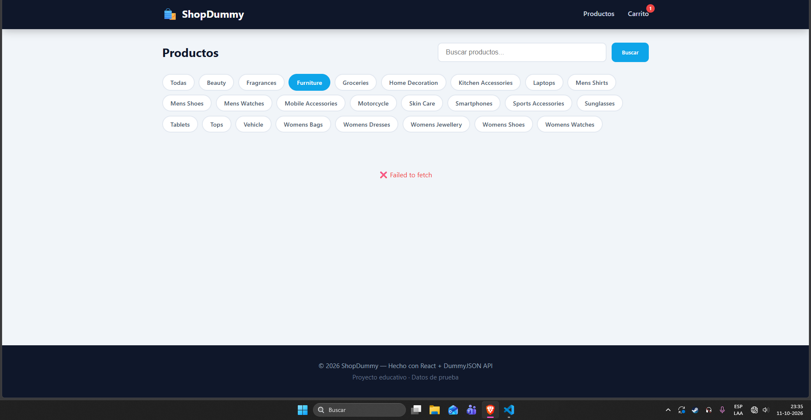
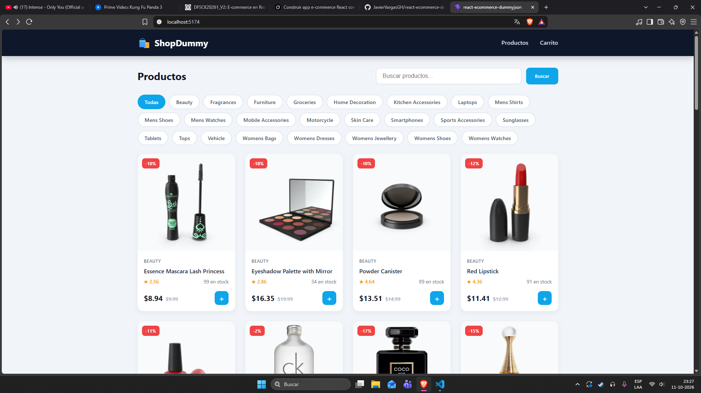
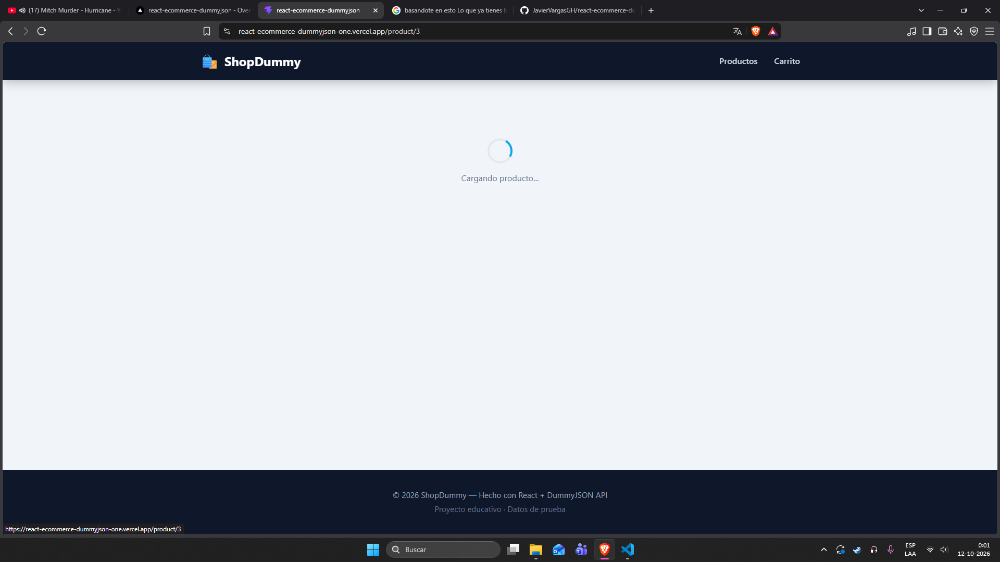
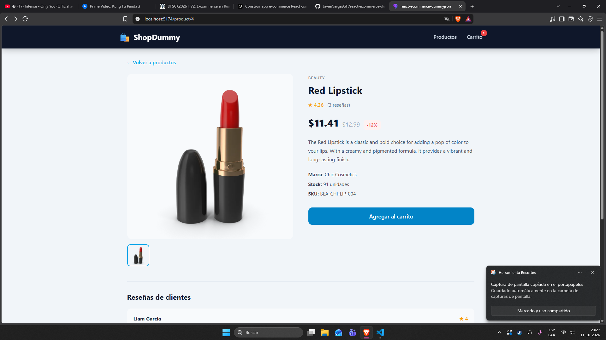
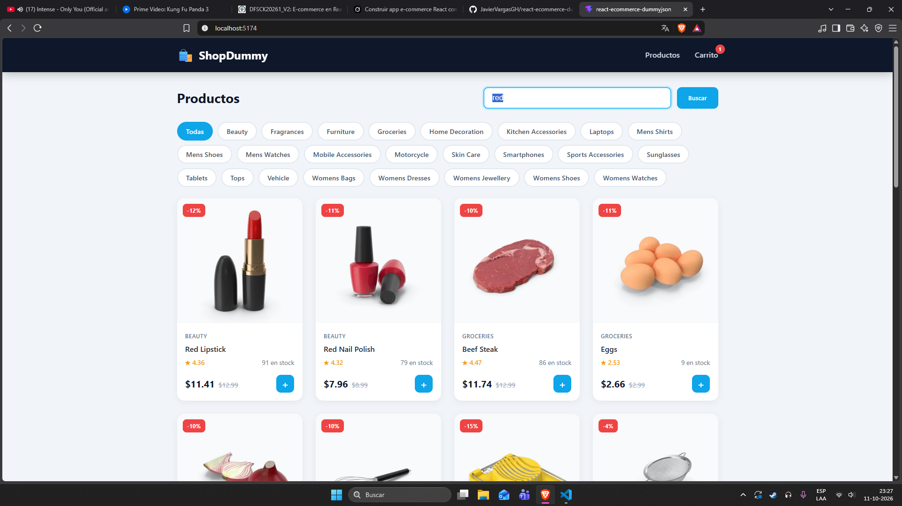

# ShopDummy - E-commerce con React + DummyJSON API

Aplicación de e-commerce construida con **React** que consume la API pública de [DummyJSON](https://dummyjson.com).  
Permite visualizar productos de forma dinámica, filtrar por categoría, buscar, ver el detalle de cada producto y gestionar un carrito de compras.

---

##  Características

- Listado dinámico de productos desde la API.
- Búsqueda de productos en tiempo real por nombre.
- Filtro avanzado por categorías.
- Página de detalle de producto con galería de imágenes y reseñas integradas.
- Carrito de compras funcional con persistencia de datos en `localStorage`.
- Estados de carga (**Loader**) y manejo de excepciones (**ErrorMessage**) mediante componentes desacoplados.
- Interfaz de usuario limpia, moderna y completamente responsive.
- Estructura de archivos modular (un componente por carpeta con sus estilos dedicados).

---

##  Tecnologías utilizadas

- **React 18** (entorno de desarrollo basado en Vite)
- **React Router DOM** (gestión del enrutamiento y navegación)
- **Context API** (administración del estado global del carrito)
- **Fetch API** (consumo y manejo de peticiones asíncronas)
- **CSS puro** (diseño responsive mediante Flexbox y CSS Grid)

---

##  Instalación y ejecución

Sigue estos pasos para clonar el proyecto y ejecutarlo en tu entorno local:

1. **Clona el repositorio:**
```bash
git clone https://github.com
cd react-ecommerce-dummyjson
```

2. **Instala las dependencias del proyecto:**
```bash
npm install
```

3. **Inicia el servidor de desarrollo local:**
```bash
npm run dev
```

---

## 📸 Capturas de Pantalla

### Vista Principal


### Búsqueda de Productos


### Tarjeta de Producto


### Estado de Carga (Loader)


### Mensaje de Error (ErrorMessage)

